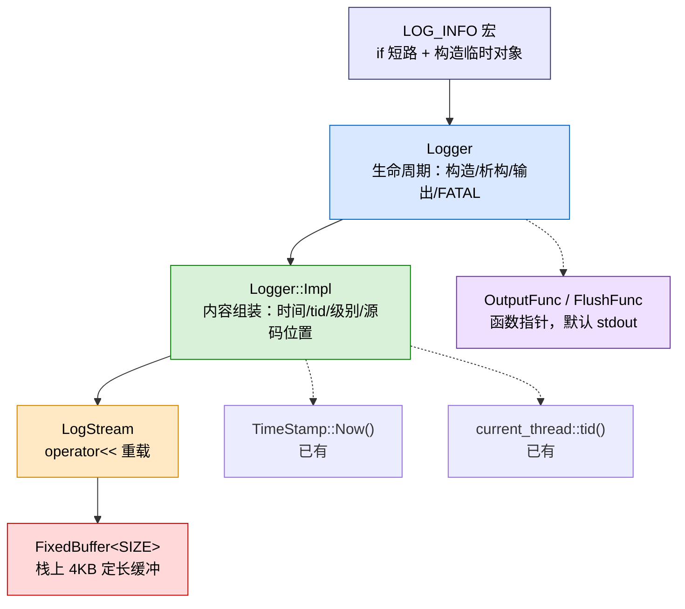
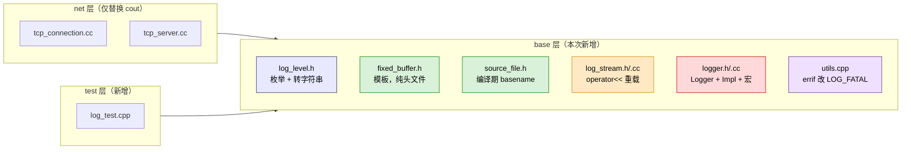

## 用户需求
为当前 C++ Reactor HTTP 服务器项目（/home/kame/NetCoding/day22）从零构建一个**同步日志库**，参考 day23 教程（muduo 风格：`Logger` + `Impl` + `LogStream` + 函数指针输出 + `LOG_*` 宏 + 析构输出 + FATAL abort）。用户对日志库尚无概念，需要方案说明每一步做什么、为什么这么做，并给出文件名与接口名。

## 已确认的四个决策
1. **目录归属**：放在 `base/` 下（`base/include/` + `base/src/`）。现有 `aux_source_directory(base/src SRC_LIST1)` 自动纳入编译，且 base 不依赖 net/http，符合自下而上分层。
2. **输出目的地**：第一版**仅 stdout**，用 `OutputFunc` / `FlushFunc` 函数指针，默认 `fwrite`/`fflush` 到 stdout。不做文件、不做滚动。
3. **接入范围**：**全部接入**，包括把 `errif` 改成 `LOG_FATAL`。
4. **前置组件**：`LogStream` / `FixedBuffer` / `SourceFile` **都不存在**，需从零一起写。

## 核心功能
- 日志级别：DEBUG / INFO / WARN / ERROR / FATAL，支持全局级别过滤
- 日志格式：`20261031 14:30:00.123456Z12345 INFO  TcpConnection::HandleClose - tcp_connection.cc:55`
- 使用方式：`LOG_INFO << "msg " << var;`
- 零成本过滤：级别不够时连参数求值都不发生
- 一条日志一次性写出，多线程不交错
- FATAL 先 flush 再 abort
- 输出目的地可通过 `setOutput` / `setFlush` 替换

## 视觉/运行效果
终端输出列对齐的日志行，时间戳精确到微秒，线程 id 右对齐，级别定宽 6 字符，末尾带源码文件行号。


## 一、技术栈
沿用项目现有栈：**C++17 + g++ + CMake + POSIX（pthread / syscall）**，无第三方依赖。日志库放在 `base/` 层，通过现有 `aux_source_directory` 自动进入 `webServer` 静态库。

## 二、实现思路（为什么这么分层）

日志库的本质是「把事实按时间顺序、以可检索格式可靠写出」。同步版的核心难点只有两个：**并发不交错** 和 **不拖慢业务**。方案用三个手段解决：

1. **栈上固定缓冲 + 一次性写出**：整条日志先在 4KB 栈缓冲里拼完，最后只调一次 `fwrite`。这样既避免了多次系统调用，也天然保证一条日志不会被其他线程插入（`FILE*` 内部锁保证单次 `fwrite` 原子）。
2. **宏内 `if` 短路**：`if (ShouldLog(level)) Logger(...).stream()`，级别不够时整条语句被短路，连 `operator<<` 都不执行，实现零成本过滤。
3. **RAII 析构输出**：`Logger` 是栈上临时对象，析构时补尾部并输出，保证提前 return / 异常路径也能落日志。

组件拆分严格对齐教程，同时对齐你项目已有的「单一职责」风格（`HttpServer`/`HttpConnection`/`HttpContext` 的拆法）：



**关键决策与理由**：

| 决策 | 理由 |
|---|---|
| `FixedBuffer` 而非 `std::ostringstream` | `ostringstream` 每次构造都堆分配，日志高频调用时开销大一个数量级；定长栈缓冲零分配 |
| `SourceFile` 编译期截 basename | 运行时截取每次都要算；模板 + `constexpr` 可在编译期完成，且 `__FILE__` 完整路径很长 |
| 时间戳同秒缓存 | `localtime_r` 要查时区表，比 `snprintf` 还贵；日志高频时 99% 落在同一秒，缓存收益显著 |
| 函数指针而非 Appender 多态 | 第一版只要 stdout，函数指针最简单；接口形态（`void(const char*, int)`）与未来 Appender 的 `Append` 一致，升级成本低 |
| `abort()` 放在 `~Logger()` 内 | 保证「先输出再崩溃」的顺序天然正确，不依赖调用方 |
| 宏统一加 `if`（含 WARN/ERROR/FATAL） | 教程原版 WARN 以上不加 `if`，导致「只输出 ERROR 以上」无法实现；统一加 `if` 语义更一致，且高级别默认级别下仍会输出 |

**性能与可靠性**：
- 单条日志复杂度 O(消息长度)，无堆分配（`FixedBuffer` 栈上），一次 `fwrite`。
- 缓冲溢出时**截断而非扩容**：日志宁可丢内容也不能崩，也避免异常路径。
- `loglevel()` 用 `std::atomic<int>`，`t_lastsecond` / `t_time` 用 `thread_local`，消除数据竞争（教程未写，但你的服务器是多线程的，必须补）。
- `~Logger()` 整体 `try/catch(...)` 兜住，避免析构抛异常触发 `std::terminate`。

**避免技术债**：完全复用 `TimeStamp`、`current_thread`、`DISALLOW_COPY_AND_MOVE`、`errif` 等既有设施；命名沿用项目风格（`snake_case` 方法、`trailing_underscore_` 成员、`k` 前缀枚举）；`FixedBuffer` 刻意与 net 层的 `Buffer` 区分命名。

## 三、实施注意（防回归）

1. **CMake 的 `aux_source_directory` 是 configure 时快照**：新增 `.cc` 后必须重新执行 `cmake`（或 `cmake ..`），否则新文件不会进库，会报 undefined reference。新增 `test/log_test.cpp` 需在 `CMakeLists.txt` 显式 `add_executable` + `target_link_libraries`。
2. **`errif` 改 LOG_FATAL 的初始化顺序**：`errif` 在 `Epoller` / `Acceptor` / `TimerQueue` 的**构造函数**里就被调用（早于任何显式初始化），因此 Logger 的全局状态必须用**函数内 static 懒初始化**（`static std::atomic<int> g_level{kInfo};`），不能依赖 `main` 里先调初始化函数。
3. **`errif` 语义变化**：原实现是 `perror + exit(EXIT_FAILURE)`，改成 `LOG_FATAL` 后是 `fwrite + fflush + abort()`。`abort` 不执行栈展开、不产生 core 之外的清理，行为差异要在注释中写明；同时保留 `errno` 信息（`strerror(errno)` 拼进消息），否则丢失 `perror` 的可读性。
4. **宏的悬垂 else**：`if (x) LOG_INFO << "a"; else ...` 会编译错误。约定「`LOG_*` 必须单独成句或加花括号」，在头文件注释中写明。
5. **时间戳格式差异**：现有 `TimeStamp::ToFormattedString()` 输出 `%Y-%m-%d %H:%M:%S.%06ld`（带横杠），日志需要 `%Y%m%d %H:%M:%S.%06dZ`（无横杠）。**不改动 `ToFormattedString()`**（避免影响其他潜在调用方），在 `Logger::Impl::FormattedTime()` 内部自行 `localtime_r + snprintf`。
6. **`current_thread::tid_string()` 末尾自带一个空格**（`"%5d "`），拼接时不要再补空格，否则会多一列。
7. **日志级别与现有 `std::cout` 的映射**：`tcp_connection.cc` 的 4 处、`tcp_server.cc` 的 2 处按语义映射（断开连接→INFO，错误→ERROR，高频关闭日志→DEBUG）；`test/` 目录下的 `std::cout` **不改**（属于测试输出，不是服务器日志）。
8. **`http/` 层无需改动**：grep 确认 `http/src/` 下 5 个 `.cc` 既无 `std::cout` 也无 `errif` 调用。
9. **`errif` 的 12 个调用点不逐个改**：只改 `errif` 的实现（内部走 `LOG_FATAL`），调用点保持原样，改动面最小、回归风险最低。

## 四、架构设计



依赖方向：`logger` → `log_stream` → `fixed_buffer`，`logger` → `source_file` / `log_level` / `timestamp` / `current_thread`。无循环依赖，全部在 base 层内。

## 五、目录结构

```
day22/
├── CMakeLists.txt                              # [MODIFY] 新增 log_test 可执行目标
├── base/
│   ├── include/
│   │   ├── log_level.h                         # [NEW] 日志级别枚举与名称转换
│   │   ├── fixed_buffer.h                      # [NEW] 栈上定长缓冲模板（纯头文件）
│   │   ├── source_file.h                       # [NEW] 编译期 basename 推导（纯头文件）
│   │   ├── log_stream.h                        # [NEW] 日志流，operator<< 重载声明
│   │   ├── logger.h                            # [NEW] Logger + Logger::Impl + LOG_* 宏
│   │   └── utils.h                             # [MODIFY] errif 注释说明改为 LOG_FATAL
│   └── src/
│       ├── log_stream.cc                       # [NEW] operator<< 实现（snprintf 写入缓冲）
│       ├── logger.cc                           # [NEW] Logger/Impl 实现、全局级别、输出函数指针
│       └── utils.cpp                           # [MODIFY] errif 内部改用 LOG_FATAL
├── net/src/
│   ├── tcp_connection.cc                       # [MODIFY] 4 处 std::cout → LOG_*
│   └── tcp_server.cc                           # [MODIFY] 2 处 std::cout → LOG_*
└── test/
    └── log_test.cpp                            # [NEW] 多线程日志正确性验证
```

### 各文件详细说明

**base/include/log_level.h** [NEW]
- 用途：定义日志级别，供 `Logger` 与宏使用。
- 功能：`enum class LogLevel { kTrace, kDebug, kInfo, kWarn, kError, kFatal }`；`const char* LogLevelName(LogLevel)` 返回定宽 6 字符的名称（`"TRACE "` / `"DEBUG "` / `"INFO  "` / `"WARN  "` / `"ERROR "` / `"FATAL "`）。
- 实现要求：纯头文件（枚举 + `inline` 函数），不产生 .cc。定宽在函数内用 `switch` 返回字面量，避免运行时 `Template` 填充开销。

**base/include/fixed_buffer.h** [NEW]
- 用途：日志消息的栈上定长缓冲区，替代 `std::ostringstream` 消除堆分配。
- 功能：`template<int SIZE> class FixedBuffer`，接口 `append(const char*, size_t)`、`data()`、`length()`、`avail()`、`reset()`、`bzero()`。
- 实现要求：`char data_[SIZE]` 成员数组；`append` 时若空间不足则**截断**（只拷贝 `avail()` 字节），不扩容不抛异常；`length()` 返回 `cur_ - data_`。命名刻意区别于 net 层 `Buffer`，避免混淆。

**base/include/source_file.h** [NEW]
- 用途：编译期把 `__FILE__` 截成 basename，避免日志里出现超长绝对路径。
- 功能：`class SourceFile { const char* data_; int size_; }`，构造函数 `template<int N> SourceFile(const char (&arr)[N])` 用 `constexpr` 查找最后一个 `/` 并记录偏移；`data()` / `size()` 访问器。
- 实现要求：纯头文件；`__FILE__` 是 `char[N]` 字面量，模板推导可拿到 N，从而在编译期完成截取，零运行时开销。

**base/include/log_stream.h** [NEW]
- 用途：提供 `<<` 流式接口，把数据格式化进 `FixedBuffer`。
- 功能：`class LogStream`，内部 `using Buffer = FixedBuffer<kSmallBuffer>`（`kSmallBuffer = 4000`）；`operator<<` 重载覆盖 `bool`、`short`、`unsigned short`、`int`、`unsigned int`、`long`、`unsigned long`、`long long`、`unsigned long long`、`float`、`double`、`char`、`const char*`、`const std::string&`、`const SourceFile&`、`const FixedBuffer<N>&`；`buffer()` 返回 `const Buffer&`；`append(const char*, int)`。
- 实现要求：数值类型用 `std::to_chars`（C++17）或 `snprintf` 写入内部 `char buf[32]` 再 `append`；`const char*` 用 `strlen` 后 `append`，需处理 `nullptr`（输出 `"(null)"`）；`char` 单独重载输出单字符（避免被当成整数）。不继承 `std::ostream`，避免虚函数与堆分配。

**base/include/logger.h** [NEW]
- 用途：对外暴露 `Logger` 类与 `LOG_*` 宏，是用户唯一需要 include 的头文件。
- 功能：
  - `class Logger`：`enum LogLevel` 从 `log_level.h` 引入；`using OutputFunc = void(*)(const char*, int)`、`using FlushFunc = void(*)()`；构造 `Logger(SourceFile file, int line, LogLevel level)`；析构 `~Logger()`；`LogStream& stream()`；静态 `set_level(LogLevel)` / `level()` / `set_output(OutputFunc)` / `set_flush(FlushFunc)` / `should_log(LogLevel)`。
  - 嵌套 `class Impl`：构造 `Impl(SourceFile, int line, LogLevel)`；`FormattedTime()`、`Finish()`、`stream()`、`loglevel()`、`level_` 成员。
  - 宏 `LOG_TRACE` / `LOG_DEBUG` / `LOG_INFO` / `LOG_WARN` / `LOG_ERROR` / `LOG_FATAL`，统一形态 `if (Logger::should_log(Logger::LogLevel::kXxx)) Logger(SourceFile(__FILE__), __LINE__, Logger::LogLevel::kXxx).stream()`。
- 实现要求：`Logger` 与 `Impl` 均 `DISALLOW_COPY_AND_MOVE`；宏注释中写明「必须单独成句或加花括号」；`Logger` 内持有 `Impl impl_`。

**base/src/log_stream.cc** [NEW]
- 用途：`LogStream` 的 `operator<<` 实现。
- 功能：数值格式化（`to_chars` 或 `snprintf`）、字符串追加、`SourceFile` 追加。
- 实现要求：数值缓冲用栈上 `char buf[32]`；`double` 用 `%.12g` 避免过长；所有路径最终落到 `buffer_.append()`。

**base/src/logger.cc** [NEW]
- 用途：`Logger` / `Impl` 实现与全局状态。
- 功能：
  - 全局：`static std::atomic<int> g_level{static_cast<int>(LogLevel::kInfo)}`（函数内 static 懒初始化）、`static OutputFunc g_output = default_output`、`static FlushFunc g_flush = default_flush`；`default_output` 用 `fwrite(msg, 1, len, stdout)`，`default_flush` 用 `fflush(stdout)`。
  - `Impl::Impl`：依次 `FormattedTime()` → `stream_ << current_thread::tid()` → `stream_ << LogLevelName(level)`。
  - `Impl::FormattedTime()`：用 `thread_local time_t t_lastsecond` 与 `thread_local char t_time[64]` 做同秒缓存；格式 `%04d%02d%02d %02d:%02d:%02d.` 加 `.%06dZ`；用 `Template` 或直接 `append` 保证定宽。
  - `Impl::Finish()`：`stream_ << " - " << sourcefile_ << ":" << line_ << "\n"`。
  - `~Logger()`：`try { impl_.Finish(); g_output(buf.data(), buf.length()); if (level_ == kFatal) { g_flush(); abort(); } } catch(...) {}`。
- 实现要求：`thread_local` 变量必须显式声明；`abort()` 前必须 `g_flush()`；`should_log` 读 `std::atomic` 用 `load(std::memory_order_relaxed)`。

**base/include/utils.h / base/src/utils.cpp** [MODIFY]
- 用途：`errif` 从 `perror + exit` 改为走 `LOG_FATAL`，统一错误处理出口。
- 功能：`errif(bool condition, const char* errmsg)` 内部改为 `if (condition) { LOG_FATAL << errmsg << ": " << strerror(errno); }`（`LOG_FATAL` 自带 `abort`，无需再 `exit`）。
- 实现要求：`utils.cpp` 需 `#include "logger.h"`、`<cstring>`、`<cerrno>`；保留 `errno` 可读性；12 个调用点**保持原样不改**。

**net/src/tcp_connection.cc** [MODIFY]
- 用途：替换 4 处 `std::cout` 为日志宏。
- 功能：第 73 行 `shutdown失败` → `LOG_ERROR`；第 152 行 `断开链接` → `LOG_INFO`；第 157、186 行 `发生其他错误` → `LOG_ERROR`。
- 实现要求：`#include "logger.h"`；移除不再需要的 `<iostream>`（若其他位置仍用则保留）；日志内容保留 `connfd_` 便于排查。

**net/src/tcp_server.cc** [MODIFY]
- 用途：替换 2 处 `std::cout` 为日志宏。
- 功能：第 51 行 `新链接创建` → `LOG_INFO`；第 89 行 `HandleCloseInLoop` 的删表日志 → `LOG_DEBUG`（高频，默认 INFO 级别下被过滤）。
- 实现要求：`#include "logger.h"`；`LOG_DEBUG` 中不再需要手动拼 `current_thread::tid()`（`Impl` 已自动加 tid）。

**CMakeLists.txt** [MODIFY]
- 用途：新增日志测试可执行目标。
- 功能：在末尾追加 `add_executable(log_test test/log_test.cpp)` + `target_link_libraries(log_test PRIVATE webServer)`。
- 实现要求：`base/src` 下新增的 `.cc` 由现有 `aux_source_directory` 自动纳入，无需改动 `SRC_LIST1`；但需重新执行 `cmake` 才能刷新快照。

**test/log_test.cpp** [NEW]
- 用途：同步日志库的正确性验收。
- 功能：三个用例——(1) 级别过滤：设置 `kWarn` 后 `LOG_INFO` 无输出、`LOG_ERROR` 有输出；(2) 多线程不交错：8 线程各打 10000 条带唯一序号的消息，重定向到文件后校验总行数 80000 且每行格式完整（正则匹配前缀 + 序号）；(3) 自定义输出：`set_output` 指向一个计数函数，验证被调用次数正确。
- 实现要求：用 `std::thread` + `std::atomic` 计数；校验逻辑失败时返回非 0 退出码；不依赖 gtest，沿用项目 `test/http_test.cpp` 的 `assert` 风格。

## 六、关键接口

```cpp
// base/include/logger.h
class Logger {
public:
    enum LogLevel { kTrace, kDebug, kInfo, kWarn, kError, kFatal };
    using OutputFunc = void (*)(const char* data, int len);
    using FlushFunc  = void (*)();

    Logger(SourceFile file, int line, LogLevel level);
    ~Logger();
    LogStream& stream();

    static void set_level(LogLevel level);
    static LogLevel level();
    static bool should_log(LogLevel level);
    static void set_output(OutputFunc func);
    static void set_flush(FlushFunc func);

    class Impl {
    public:
        Impl(SourceFile file, int line, LogLevel level);
        void FormattedTime();
        void Finish();
        LogStream& stream();
        LogLevel level_;
    private:
        SourceFile sourcefile_;
        int line_;
        LogStream stream_;
    };
private:
    Impl impl_;
};
```

```cpp
// base/include/fixed_buffer.h
template<int SIZE>
class FixedBuffer {
public:
    void append(const char* data, size_t len);  // 空间不足时截断
    const char* data() const;
    size_t length() const;
    size_t avail() const;
    void reset();
private:
    char data_[SIZE];
    char* cur_;
};
```


## Agent Extensions
### Skill
- **dev-workflow**
  - Purpose: 在实现阶段按「需求理解 → 方案设计 → 代码实现 → 代码审查 → Bug 修复」五步法推进日志库落地，确保每一步有明确产出
  - Expected outcome: 日志库代码按五步法有序产出，每步有可验证结果

- **code-review**
  - Purpose: 日志库与 net 层接入完成后，用七维审查清单做一次代码体检，重点检查线程安全（atomic / thread_local）、异常安全（析构 noexcept）、宏的悬垂 else 风险、缓冲截断边界
  - Expected outcome: 输出一份问题清单与修复建议，确认无阻塞级缺陷后再收尾

- **lsp-code-analysis**
  - Purpose: 接入阶段用语义分析定位 `errif` 与 `std::cout` 的全部调用点，确认改动影响面，避免遗漏
  - Expected outcome: 得到准确的调用点清单与影响范围，保证接入完整无遗漏
